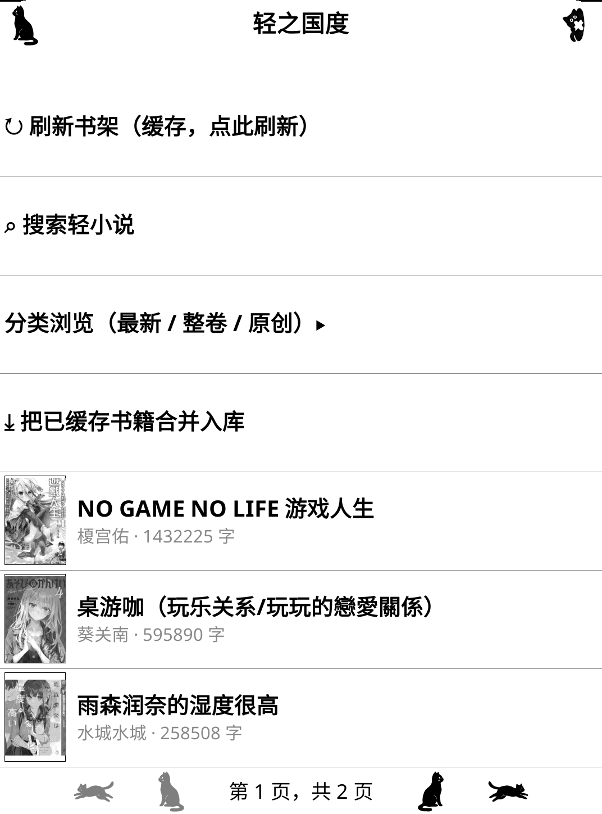

# lightnovel.koplugin

[轻之国度](https://www.lightnovel.fun) 的 KOReader 插件：书架下载、增量更新合并、评论抓取、EPUB 导出。

在 Kindle 上把轻小说变成离线 EPUB，评论（段评）附在正文里（旧书按章挂在该章末尾，新内容书按卷挂在卷末）。连载更新后只需点一下，新章节自动增量下载并合并重出 EPUB。

## 截图

**插件书架**——刷新书架、搜索、分类浏览、一键把已缓存书籍合并入库：

**插件书架**（刷新 / 搜索 / 分类浏览 / 一键合并入库）　**下载完的成品**（出现在 KOReader 书库）：

<p>
  
  
</p>

> 图为设备 framebuffer 原样输出；点击可看原图。

## 功能

| 功能 | 说明 |
|---|---|
| **增量更新合并** | 连载有新章时点「库中书更新」：只下载新章节，与已缓存内容合并，自动重出 EPUB 覆盖旧版 |
| 书架同步 | 登录账号后浏览服务器书架，支持搜索 |
| 整本缓存 | 一键缓存全部章节，断点续传，中断后重跑只补缺的 |
| 评论抓取 | 按卷归属（旧书自动核验映射、防止串书）；下载时自动抓取，补评论走同一入口 |
| 新书评论 | 站点只有新内容 ID 的书也支持：按卷走公开接口抓取，无需额外配置 |
| EPUB 导出 | 缓存 + 评论 + 插图 + 封面打包成 EPUB，直接放书架 |
| 插图缓存 | 首次下载后缓存插图，重出版不重下 |
| 任务进度 | 可隐藏 / 暂停 / 后台继续，切书不中断；菜单入口常驻，状态行显示当前阶段与进度 |
| 缓存管理 | 按书查看章数与大小，可单本删除或清除全部 |
| 诊断日志 | 菜单一键导出，USB 取走发给开发者 |

## 安装

### 需要

- 越狱 Kindle（已装 KOReader）
- KOReader v2026.07+
- 轻之国度账号（免费注册）

### 步骤

1. 把 `plugin/` 里的内容拷到 `koreader/plugins/lightnovel.koplugin/`
2. 重启 KOReader

目录结构：

```
koreader/
├── plugins/
│   └── lightnovel.koplugin/
│       ├── _meta.lua
│       ├── main.lua
│       └── lightnovel/
│           ├── lib/
│           └── ui/
```

## 使用

### 首次下载

1. KOReader 菜单 → 轻之国度 → 登录
2. 书架 → 长按一本书 → 目录页
3. 点「下载入库」——缓存全部章节 + 抓评论 + 导出 EPUB，一步到位
4. 导出的书在 `documents/Downloads/` 里，直接打开阅读

### 连载更新（最常用）

书架长按已入库的书 → 目录页 → 点「**库中书更新**」：

- 只下载**新增章节**（已缓存的不重下）
- 评论有缺的自动补抓
- 自动重出 EPUB 覆盖旧版（插图走缓存，秒级）

一部连载每次追更就点这一下。

### 其他入口

- 目录页显示「评论：全部 N 卷已入库」或「已入库 x/N 卷」——评论缺没缺一目了然
- 评论以附录形式嵌入 EPUB：旧书挂在章节末尾，新内容书挂在卷末

## 遇到问题

菜单 → 导出诊断日志 → USB 连电脑 → `documents/lightnovel-诊断-*.txt` 发给开发者。

日志不含登录凭据。

## 已知限制

- EPUB 插图不压缩（设备端无 JPEG 编码器）
- 评论归属依赖站点数据：合卷 / 重置版的书若站点本身没有给评论，插件不会凭空生成
- 搜索结果最多显示 3 页

## License

MIT


## 免责声明

- 本插件**仅供个人学习交流使用，严禁用于任何商业用途**。
- 书籍内容版权归原翻译、扫图、录入、校对者及 [轻之国度](https://www.lightnovel.fun) 所有，
  请尊重上述人员的辛勤劳动；转载请注明来源。
- 下载的内容请**在 24 小时内删除**；由此产生的任何后果由使用者自行承担，
  轻之国度（LK）与本插件作者不承担任何责任。
